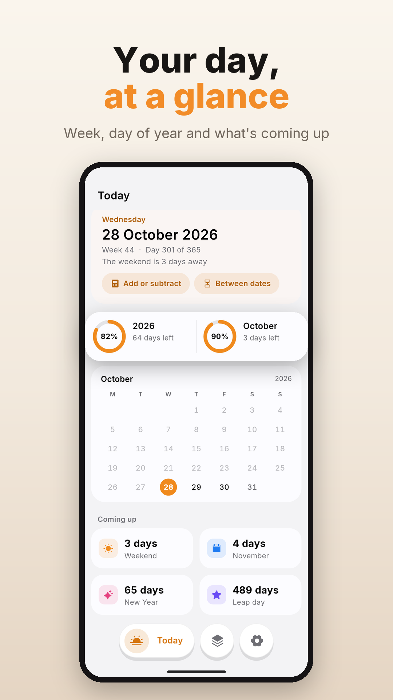
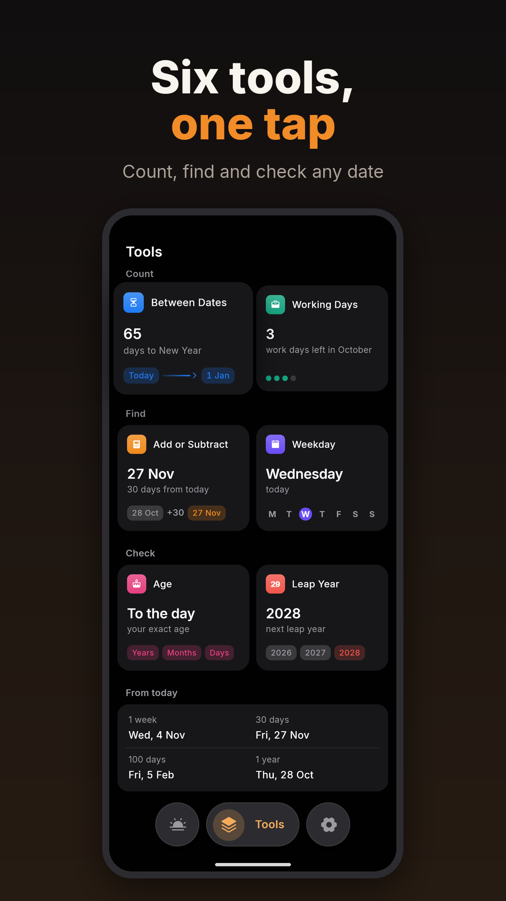
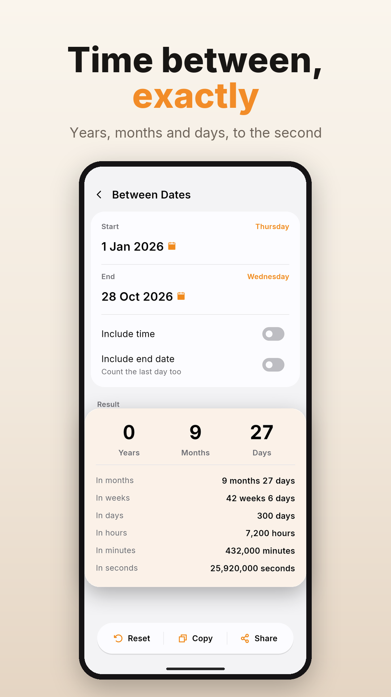
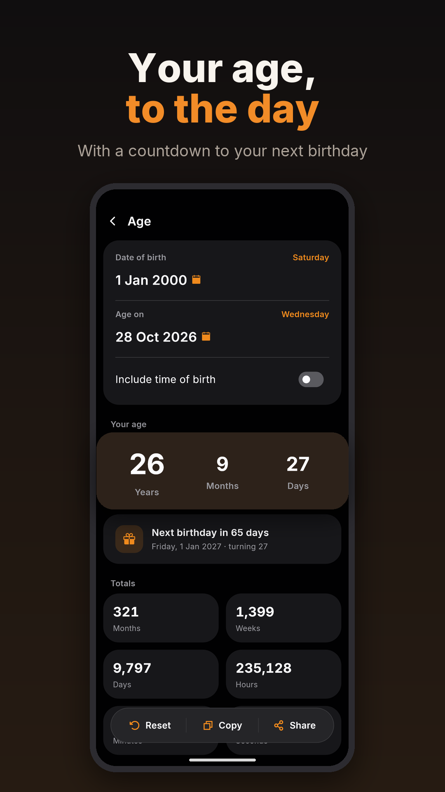
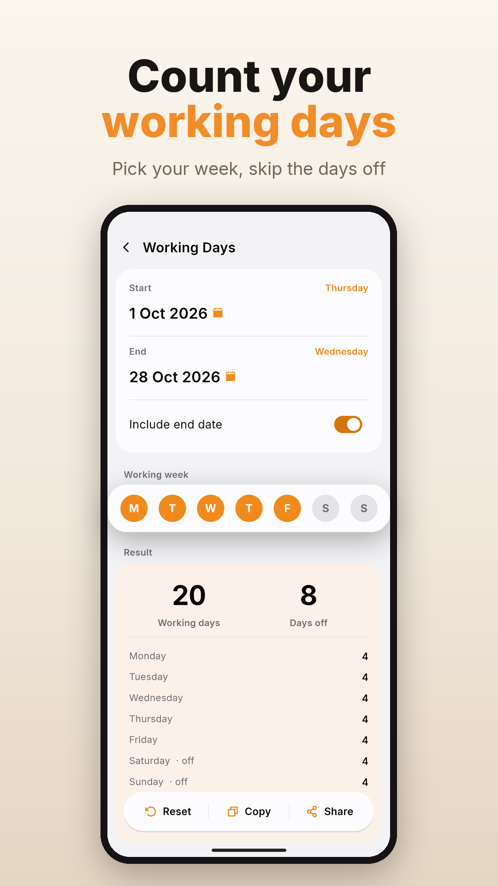
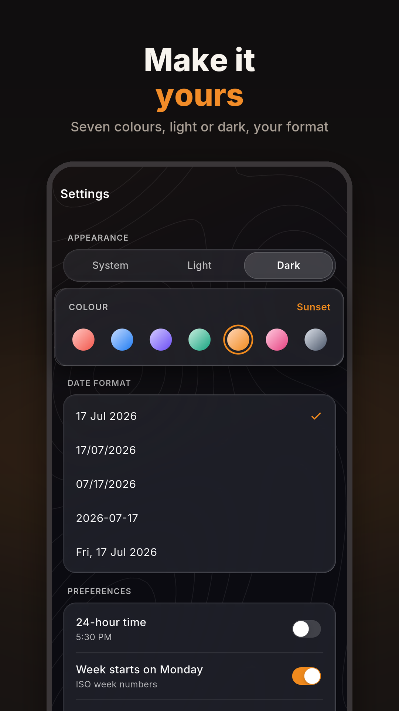
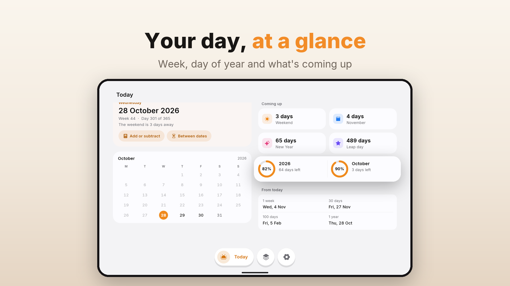

# Dates

A simple date calculator and day counter for Android: days between dates, exact age, working days and countdowns. No ads, no account, no permissions, works offline.

<p>



</p>
<p>



</p>



## Download

Get the latest APK from [Releases](https://github.com/GagandeipSingh/dates/releases/latest). Most phones use the **arm64-v8a** file. Requires Android 7.0 or newer.

## Features

- **Days between dates:** years, months and days, or total weeks, hours, minutes and seconds
- **Age:** your exact age, with a countdown to your next birthday
- **Working days:** count business days with your own work week
- **Add or subtract days:** find the date any number of days before or after another
- **Today:** week number, day of year, year and month progress, and countdowns to the weekend, next month, New Year and the next leap day
- **More tools:** weekday finder and leap year checker
- **Make it yours:** light and dark theme, seven colours, your date format, 24-hour time, Monday start
- **Any screen:** phones, tablets, foldables and desktop mode

## Build

```
flutter pub get
flutter run
```

Release builds read signing details from `android/key.properties`, which is not in this repo. Without it, release builds fall back to the debug key.

## Privacy

Dates asks for no permissions and collects no data. Settings stay on your device.
